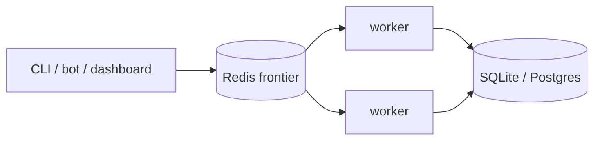

# crawlnet

Распределённый краулер на asyncio: общая очередь в Redis, YAML-спайдеры без кода, SQLite/Postgres, дашборд и Telegram-бот. Для тех, кому нужны несколько воркеров на разных машинах без отдельного координатора.

{{скриншот}}

## Возможности

- Общая очередь в Redis (`ZSET` по времени) с приоритетами, отложенными ретраями и вежливостью между машинами
- At-least-once: `inflight` + reaper; повторный `ack` не ломает счётчики
- `robots.txt` с кэшем, `Crawl-delay`, 401/403 как закрытый сайт (RFC 9309)
- Дедуп по каноническому URL, upsert по `(spider, key)` с версиями при изменении данных
- YAML-спайдеры, экспорт CSV/Excel, веб-дашборд и Telegram-бот
- Локальный режим без инфраструктуры (очередь в памяти, SQLite)

## Архитектура



## Стек

Python 3.12 · asyncio · Redis · httpx · parsel · SQLAlchemy · FastAPI · aiogram 3 · Docker

## Запуск

Без инфраструктуры:

```bash
pip install -e ".[dev]"
make run
# или: crawlnet run quotes --export xlsx
```

Кластер в Docker (дашборд на http://localhost:8000). Задайте `CRAWLNET_DASHBOARD_PASSWORD` в `.env`, иначе контейнер дашборда не стартует наружу:

```bash
cp .env.example .env
docker compose up -d --build
docker compose exec worker crawlnet submit books
docker compose up -d --scale worker=6
docker compose --profile bot up -d   # нужен CRAWLNET_TG_TOKEN
```

| команда | что делает |
|---|---|
| `crawlnet submit <spider>` | поставить задачу в общую очередь |
| `crawlnet worker -c 16` | воркер с 16 параллельными запросами |
| `crawlnet jobs` / `cancel <id>` | список и отмена |
| `crawlnet export <id> -f csv\|xlsx` | выгрузка |
| `crawlnet validate <file.yaml>` | проверить спайдер |
| `crawlnet dashboard` / `bot` | веб и Telegram |

Тесты и стиль: `make test`, `make lint`, `make fmt`.

## Конфиг

| Переменная | Назначение |
| --- | --- |
| `CRAWLNET_REDIS_URL` | Redis для frontier |
| `CRAWLNET_DB_URL` | Async SQLAlchemy URL результатов |
| `CRAWLNET_SPIDERS_DIR` | Каталог YAML-спайдеров |
| `CRAWLNET_PREFIX` | Префикс ключей Redis |
| `CRAWLNET_INFLIGHT_TIMEOUT` | Таймаут claim до reclaim |
| `CRAWLNET_TG_TOKEN` / `CRAWLNET_TG_ALLOWED` | Telegram-бот и allow-list |
| `CRAWLNET_DASHBOARD_PASSWORD` | HTTP Basic для дашборда |

Полный список — в `.env.example`. Пример спайдера: [spiders/quotes.yaml](spiders/quotes.yaml).

## Ограничения

- Только статический HTML (JS — отдельный Playwright-fetcher).
- `seen:{job}` — SET; для сотен миллионов URL лучше Bloom.
- `ZPOPMIN` и запись в `inflight` — две команды; падение между ними закрывается Lua.

## Автор

Богдан Щербинин ([blessed-bless](https://github.com/blessed-bless))
