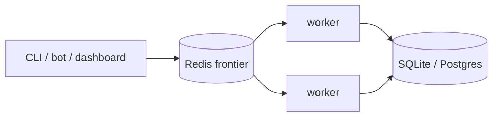

# crawlnet

Распределённый краулер на asyncio: общая очередь в Redis, YAML-спайдеры без кода, выгрузка в CSV/Excel. Для тех, кому нужны несколько воркеров на разных машинах без отдельного координатора.

{{скриншот}}

## Возможности

- Общая очередь в Redis с приоритетами, отложенными ретраями и вежливостью между машинами
- At-least-once: `inflight` + reaper; повторный `ack` не ломает счётчики
- `robots.txt` с кэшем и `Crawl-delay`; 401/403 как закрытый сайт
- Дедуп по каноническому URL, upsert по `(spider, key)` с версиями при изменении данных
- YAML-спайдеры, веб-дашборд и Telegram-бот
- Локальный режим без инфраструктуры (очередь в памяти, SQLite)

## Архитектура



## Стек

Python 3.12 · asyncio · Redis · httpx · parsel · SQLAlchemy · FastAPI · aiogram 3 · Docker

## Запуск

Без Docker (очередь в памяти, SQLite):

```bash
git clone https://github.com/blessed-bless/crawlnet.git
cd crawlnet
pip install -e ".[dev]"
crawlnet run quotes --export xlsx
```

Кластер: `cp .env.example .env`, задай `CRAWLNET_DASHBOARD_PASSWORD`, затем `docker compose up -d --build`.

## Конфигурация

| Переменная | Назначение |
| --- | --- |
| `CRAWLNET_REDIS_URL` | Redis для frontier |
| `CRAWLNET_DB_URL` | Async SQLAlchemy URL результатов |
| `CRAWLNET_SPIDERS_DIR` | Каталог YAML-спайдеров |
| `CRAWLNET_PREFIX` | Префикс ключей Redis |
| `CRAWLNET_INFLIGHT_TIMEOUT` | Таймаут claim до reclaim (сек) |
| `CRAWLNET_TG_TOKEN` | Токен Telegram-бота |
| `CRAWLNET_TG_ALLOWED` | Allow-list user id через запятую |
| `CRAWLNET_DASHBOARD_PASSWORD` | HTTP Basic для дашборда |

Полный список — в `.env.example`. Пример спайдера: [spiders/quotes.yaml](spiders/quotes.yaml).

## Автор

Богдан Щербинин ([blessed-bless](https://github.com/blessed-bless))
